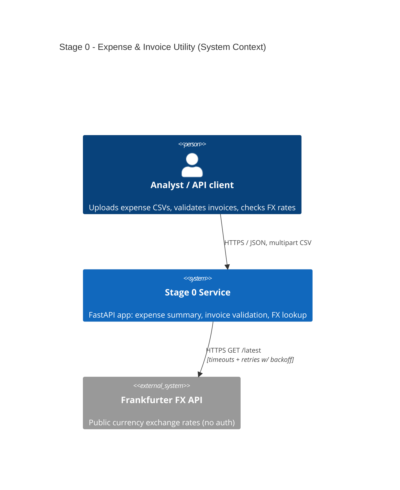
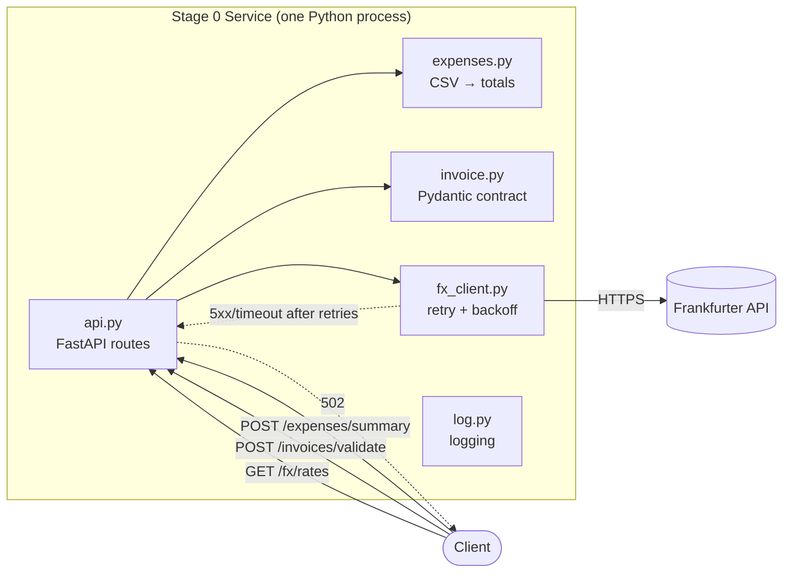

# C4 · Level 1 (System context) and Level 2 (Containers): Stage 0 service

**Where this goes next:** in Stage 2 the "FX API" box becomes an LLM API (same retry and timeout concerns, plus token cost), and `invoice.py` becomes the structured-output schema for an LLM invoice extractor.
